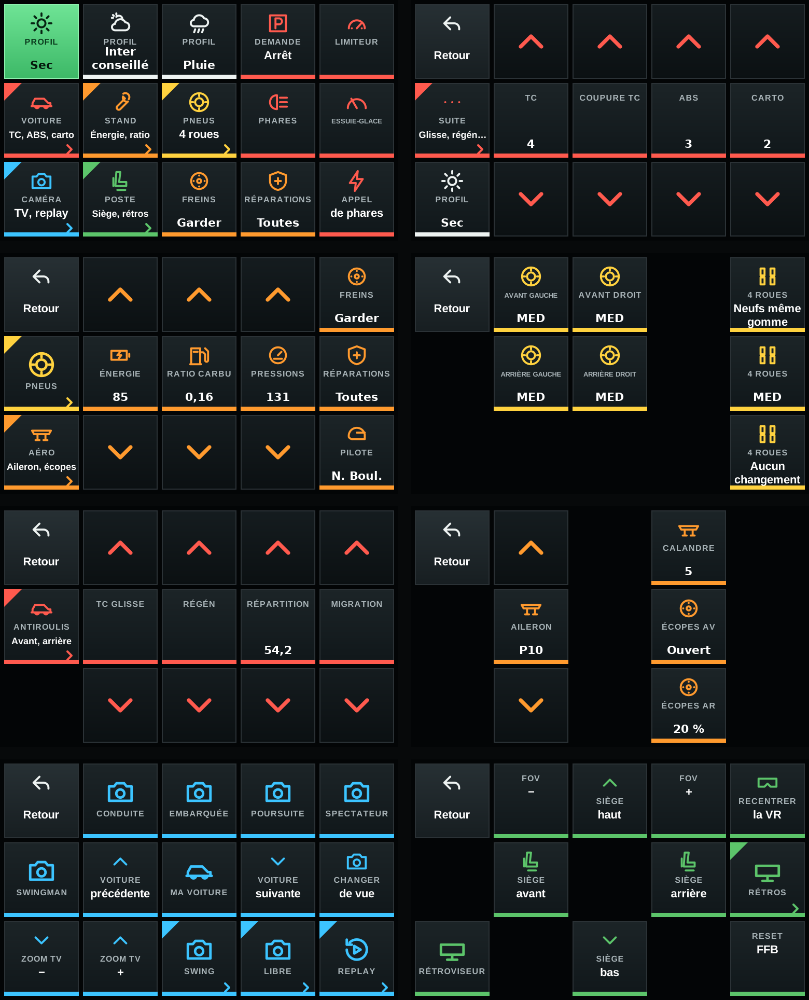

# Profil Stream Deck « Endurance Manager · FMT »

Stream Deck MK.2 (15 touches). Maquette validée par Nathan le 24/11/2026 : https://claude.ai/artifact/Gi7MJDFribekYZYFzec85g

## Installer (pilote)

1. Logiciel Stream Deck 7.6 ou plus, SimHub 9.13.6 ou plus. Installer le plugin Stream Deck **Simhub dynamic button** :
   double-cliquer `C:\Program Files (x86)\SimHub\_Addons\StreamDeckPlugins\com.wotever.simhubdynamicbutton.streamDeckPlugin`.
2. Plugin Endurance Manager : activer **Black box sur boutons** (rôles « FMT - … ») et **Réglages voiture en course**
   (rôles « EM - Profil 1/2/3 »).
3. Double-cliquer `Endurance Manager FMT.streamDeckProfile`.

## Ce qu'il montre

- Accueil : les 3 profils (vert = actif, « conseillé » quand l'humidité de la piste le demande), demande d'arrêt,
  limiteur, phares, essuie-glace, freins, réparations, appel de phares, et les dossiers Voiture, Stand, Pneus, Caméra,
  Poste.
- Voiture et Stand : un réglage par colonne, plus en haut, valeur en direct au milieu, moins en bas.
- Une couleur par famille : Voiture rouge, Stand orange, Pneus jaune, Poste vert, Caméra bleu.
- Toutes les touches de réglage sont des boutons dynamiques de SimHub : image SVG, valeur en direct en bas, vert quand
  c'est actif (profil appliqué, limiteur, phares, essuie-glace), appui = rôle du Control Mapper. Chaque touche se
  retouche dans SimHub (« Edit in SimHub » dans le logiciel Stream Deck).
- Valeurs en direct : propriétés SimHub (`DataCorePlugin.GameData.*`), FMT companion (`FMTCompanionPlugin.Pit.*`) et
  plugin (`EnduranceManagerPlugin.Profils.N.Titre`, `.Actif`). Les niveaux TC, coupure, glisse, ABS, carto, migration, antiroulis et la répartition proviennent de `EnduranceManagerPlugin.Voiture.Reglages.*` (mémoire LMU). La régénération est une puissance lue en kW, pas un niveau de réglage. Un tiret signale une valeur indisponible lorsque la télémétrie est présente. Le rendu réel doit être validé dans SimHub.

- Ravitaillement : énergie virtuelle en % si disponible, sinon carburant en litres ; un tiret si le menu est indisponible. Les boutons +/− utilisent le choix du menu LMU existant.
- Ne jamais définir d'image personnalisée dans Stream Deck sur une action SimHub : elle bloque le rendu dynamique. Réinitialiser l'icône par défaut si nécessaire. Le SVG est exclusivement configuré dans SimHub. Les dossiers et la navigation conservent leur image fixe.
- Typographie adaptée par touche : grands chiffres pour les niveaux, police réduite pour les noms et états longs. Les tailles du moteur SimHub et le rendu sur MK.2 restent à vérifier en jeu.

## Refaire le profil

`python3 streamdeck/build.py` (avec `cairosvg` et `pillow`) réécrit le profil et `apercu.png`. Les touches sont
décrites dans `PAGES` de `build.py`.

Format d'une touche : celui des boutons exportés par SimHub (`.shsdb`), gardé dans les réglages de l'action Stream
Deck. Lu dans les modèles de SimHub (`SimHub\StreamDeckButtonsTemplates`) et dans une touche faite par Nathan le
24/11/2026 (appui sur un rôle : `"OnPress": {"ActionMode": 3, "ControlMapperRoleName": "…"}`).
